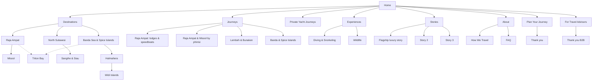

# 1000 Islands Travel — Sitemap v0.1

**Date:** 1 October 2026 · **Status:** internal draft, before keyword data (B4) and owner answers (A1). Names, URLs and the journey list will change.
**Scope baseline:** `Offer_Sent_to_Owner.md`: 3–4 commercial landings + B2B section, small CMS, simple leads system. The page count is fixed when the structure is approved.

Markers: ◆ confirmed · ◈ likely · ◇ our proposal

---

## v0.3 — after the owner call, corrected by the user (2 Oct 2026). Supersedes the tree below where they differ.

```text
Home
├─ Destinations
│  ├─ Raja Ampat ★ landing (the whole archipelago, broad)
│  │   ├─ Central Raja Ampat      sub-direction (section or page)
│  │   └─ Misool                  sub-direction (section or page)
│  ├─ Triton Bay ★ landing
│  └─ North Sulawesi: Bunaken & Beyond   (Lembeh removed, owner) ── Sangihe & Siau
├─ Journeys
│  ├─ Individual journeys (the main product)
│  └─ Group tours — placeholder page, template ready, opened later
├─ Private Yachts ★ landing
├─ Stories · About · How We Travel · FAQ
├─ For Travel Advisors (B2B)
└─ Plan Your Journey → Thank you
```

**Decisions (user, 2 Oct):**
- **Diving has no page of its own.** It is the main activity on the trips, so it runs through every page (journeys, destinations, yachts). We do not focus on it as a section: the trips are not only diving, a non-swimmer still has a great trip. No wildlife / volcano pages: no ideas yet.
- **Raja Ampat** = one broad landing; it divides only into Central Raja Ampat and Misool (no third zone).
- **Lembeh: removed** (the owner's request on the call: "labeh idet nahui"). Correction 5 Oct 2026: an earlier note here said the user wanted to keep it; that was wrong. Sangihe & Siau stays.
- **Banda / Spice Islands: not at launch.** Halmahera and Widi lived under that umbrella → parked, to confirm with the owner.
- **Luxury camping: removed.** An idea for the future, not a launch item (kept in PLAN §9 as an idea).
- **Individual tours are the main product.** Group tours: the owner wants them but there are none yet → a placeholder, built so they can be added later (direction, description, photos, dates). No separate admin cabinet: the offer's small CMS only.
- **Price: no configurator** (prices float, the owner prefers to confirm personally). Instead each direction shows **"from $X" by number of days**: a small table (e.g. 7 / 10 / 14 days → minimum price). Final price after the enquiry.
- **Reply within 24 h, 7 days a week.**
- Landings now: Raja Ampat, Triton Bay, Private Yachts (+ the B2B section). A 4th is optional (North Sulawesi?).

---

## 1. Principles

1. **One site, one brand.** B2B and B2C use the same product pages but have separate conversion paths.
2. **The menu answers the visitor's questions:** Where can I go? (Destinations) · What can I book? (Journeys) · How do I travel? (Private Yachts, Experiences) · Why trust you? (Stories, About) · I'm a professional (For Travel Advisors) · How do I start? (Plan Your Journey).
3. **Three hubs with child places, flat URLs.** Hub membership is shown with links and cards, not nested URLs.
4. **Trip styles everywhere.** Every hub and journey shows the styles (◇ e.g. island lodge / premium / private yacht) with "from" prices.
5. **Every page ends in a call to action.** Every product page also has a small "Travel advisor? Get agent rates" link.
6. **No thin pages.** A child destination without its own photos and facts stays a section of its hub until it has them.
7. **Ad landing pages** (our B2C campaigns) live outside the menu and are hidden from Google (noindex).

---

## 2. Navigation

**Desktop header:**
Logo "1000 Islands Travel · Remote Indonesia" · Destinations ▾ · Journeys · Private Yachts · Experiences ▾ · Stories · About ▾ · *For Travel Advisors* (secondary style) · **[Plan Your Journey]**

**Mobile:** logo + menu; a sticky bottom bar with **Plan Your Journey** and **WhatsApp**.

**Footer:** destinations · journeys · company (About, How We Travel, FAQ, Stories) · For Travel Advisors · WhatsApp, email · social links · Privacy.

---

## 3. Page tree at launch

| # | Page | URL | Template | Notes |
|---|---|---|---|---|
| 1 | Home | `/` | T1 | both audiences |
| 2 | Destinations | `/destinations/` | T4 | map of the three regions |
| 3 | **Raja Ampat** | `/destinations/raja-ampat/` | T2 hub | main SEO + ads page |
| 4 | Misool | `/destinations/misool/` | T3 short | or a section of #3 |
| 5 | Triton Bay | `/destinations/triton-bay/` | T3 short | linked from #3 and #8 |
| 6 | **North Sulawesi: Bunaken, Lembeh & Beyond** | `/destinations/north-sulawesi/` | T2 hub | Bunaken and Lembeh as sections |
| 7 | Sangihe & Siau | `/destinations/sangihe-siau/` | T3 short | |
| 8 | **Banda Sea & Spice Islands** | `/destinations/banda-sea-spice-islands/` | T2 hub | |
| 9 | Halmahera | `/destinations/halmahera/` | T3 short | |
| 10 | Widi Islands | `/destinations/widi-islands/` | T3 short | strong candidate to stay a section of #9 |
| 11 | Journeys | `/journeys/` | T4 | simple grid, no filters at launch |
| 12–15 | 4 sample journeys | `/journeys/<slug>/` | T5 | working candidates below |
| 16 | **Private Yacht Journeys** (incl. luxury) | `/private-yachts/` | T7 → landing | phinisi + luxury, flagship story |
| 17 | Diving & Snorkeling | `/experiences/diving-snorkeling/` | T7 | |
| 18 | Wildlife | `/experiences/wildlife/` | T7 | |
| 19 | Stories | `/stories/` | T4 | |
| 20–22 | 3 guest stories | `/stories/<slug>/` | T6 | #1 = the luxury trip (boats + helicopter) |
| 23 | **For Travel Advisors** | `/travel-advisors/` | T8 | own B2B form |
| 24 | How We Travel | `/how-we-travel/` | T9 | process, trip styles, logistics, safety |
| 25 | About | `/about/` | T9 | story, team, people on the ground |
| 26 | FAQ | `/faq/` | T9 | |
| 27 | Plan Your Journey | `/plan-your-journey/` | T10 | B2C form (+ optional budget estimator) |
| 28 | Thank you (B2C) | `/plan-your-journey/thank-you/` | T10 | conversion event |
| 29 | Thank you (B2B) | `/travel-advisors/thank-you/` | T10 | conversion event |
| 30 | Privacy Policy | `/privacy/` | T9 | |
| 31 | 404 | — | T11 | |

**Outside the menu:** campaign landing pages `/go/<campaign>/` (noindex) for our B2C ads. Not part of the 35m scope.

**Later (not at launch):** Komodo, Alor, Sumba, Kalimantan, Sumatra; Volcanoes, Family, Photography experiences; travel guides / blog.

**Working journey candidates (◇, to be replaced by real trips from the owner):**
1. Raja Ampat by island lodge and private speedboat, ~8–10 days (lodge style)
2. Raja Ampat & Misool by private phinisi (yacht style)
3. North Sulawesi: Lembeh muck diving + Bunaken + tarsiers (diving / wildlife)
4. Banda Sea & Spice Islands (expedition / history)

**Total:** ~31 URLs, **11 templates**. Only the templates are designed; the pages are filled from content files.

### Commercial landings (offer: 3–4 + the B2B section)

| Landing | Status | Why |
|---|---|---|
| Raja Ampat | ✔ certain | flagship in both the interview and the offer |
| Private Yacht Journeys | ✔ certain | in the offer; the luxury section lives here |
| For Travel Advisors (B2B) | ✔ certain | "B2B section worked out separately" |
| Triton Bay | ? | in the offer's examples and the owner's copy; ◈ niche demand (whale sharks, divers) |
| North Sulawesi | ? | interview Tier 2; ◈ a large dive market (Lembeh, Bunaken) |
| Banda Sea & Spice Islands | ? | interview Tier 3 |

◇ Pick 1–2 of the "?" rows using the owner's answers + keyword volumes. The rest become ordinary destination pages (lighter template, still full of real content).

### CMS: what the owner edits himself (per the offer)
Photos, galleries, reviews, part of the simple text (e.g. prices "from", seasons, contacts). New Journeys / Destinations / Stories are added by us from the existing templates. So templates must be data-driven: a new journey = a new content file, not a new design.

### Leads system (per the offer)
Both forms (B2C and B2B) write to one list: name, contact, B2B/B2C, destination, dates, travellers, **source** (UTM / referrer / WhatsApp code), status, comments. Stages: New → Contacted → Proposal → Negotiation → Won / Lost. WhatsApp clicks are tracked as events; WhatsApp enquiries are entered by hand with their source code.

---

## 4. Templates (what gets designed in Figma)

| Template | Used by |
|---|---|
| T1 Home | Home |
| T2 Destination hub | Raja Ampat, North Sulawesi, Banda Sea |
| T3 Destination short | Misool, Triton Bay, Sangihe & Siau, Halmahera, Widi |
| T4 Listing | Destinations, Journeys, Stories |
| T5 Journey | 4 journeys |
| T6 Guest story | 3 stories |
| T7 Feature page | Private Yachts, Diving & Snorkeling, Wildlife |
| T8 B2B landing | For Travel Advisors |
| T9 Text page | How We Travel, About, FAQ, Privacy |
| T10 Form + thank-you | Plan Your Journey, both thank-you pages |
| T11 System | 404 |

**Shared components:** header, mobile menu, footer, sticky mobile bar · destination card · journey card (style + days + "from" price) · story card · trip-style badge · review block · map block · FAQ accordion · CTA band · B2C form · B2B form · "agent rates" mini-link.

---

## 5. Section outlines for the key templates

### T1 Home
1. **Hero:** "Remote Indonesia. Off the map." + a "made easy" line. Buttons: Explore journeys / Plan your journey.
2. **Three regions:** map + three hub cards.
3. **Featured journeys:** 4 cards with style, days and "from" price.
4. **Made easy:** the problem (hard to organise alone) → 4 steps: Tell us → We design it → We handle everything → You travel.
5. **Trip styles:** island lodge / premium / private yacht & luxury.
6. **Proof:** the flagship luxury story + 2–3 reviews. Numbers only if they are real.
7. **Experiences:** yachts, diving, wildlife.
8. **For travel advisors:** teaser, "Your client remains your client" → `/travel-advisors/`.
9. **People on the ground:** team / About teaser.
10. **Start with an idea:** short form or WhatsApp.

### T2 Destination hub
Hero → why go (3–4 points) → map + child places → trip styles with "from" prices → **where you stay & sail** (named lodge and boat cards, as Jacada and Steppes do) → sample journeys → experiences here → best time to go → getting there & what to expect (logistics, honest accommodation level) → stories and reviews from this region → FAQ (3–5) → call to action + agent-rates link.

### T5 Journey
Hero + one-line pitch → facts bar (days, region, style, best months, "from" price) → highlights → route map → day by day → where you stay / the boat → what can be changed → included / not included → related story → FAQ → call to action (form pre-filled with this journey) + agent-rates link.

### T7 Private Yacht Journeys (landing)
Hero → why travel by yacht (owner's copy: "we choose the boat around the journey") → where you'll sail (Raja Ampat, Misool, Banda…) → **packages by length** (e.g. 5 / 7 / 9 / 11 days) with "from $X per night, whole boat" → our boats (named cards, if the owner allows) → the flagship luxury story (helicopter + boats) → what's included → private charter vs a cabin on a shared boat → FAQ → call to action + "reply within 24 h".

### T8 For Travel Advisors (B2B section, v0.2, 1 Oct 2026)

**Job of the page:** an advisor who got our outreach email (or found us) understands in 2 minutes that we are real, safe to hand a client to, and easy to work with, then registers or sends a client request. Mostly not an SEO page.

**What it is:** one public page plus an offline **partner kit**. No partner portal or login (not in the offer, and not needed at this volume).

**Blocks:**
1. **Hero:** "Your local partner for remote Indonesia". For travel advisors, agencies, tour operators, concierge. Buttons: *Become a partner* · *Request a trade quote* (wording from parallel research, 2 Oct; matches trade usage).
2. **The problem:** "Indonesia is easy. Until it isn't." (owner's line): Bali is easy, Raja Ampat / Triton Bay / Banda are not.
3. **What we handle,** grouped: itinerary design · yachts, phinisi, lodges, remote stays · flights, boats, transfers · diving, guides, permits · 24/7 support on the ground.
4. **How we work with you** (the terms block, the heart of the page):
   - one retail price; commission or net rates for registered partners (◇ the % is not shown publicly);
   - **we never sell to your client below the price you quote**;
   - client protection: your client stays yours, even if they contact us directly;
   - white-label: documents without our logo, we stay behind the scenes;
   - payment terms and currency (owner's input);
   - first proposal within X hours (◈ industry norm: 24–48 h for a first draft), named contact, 24/7 line during trips.
5. **Where we operate:** map of the three regions + links to the journeys as the product catalogue ("unbranded versions on request").
6. **Proof:** registered company, tourism licence, insurance, memberships, years operating, trips run (only real numbers), the flagship luxury trip, quotes from partner agents (if any exist).
7. **How a booking works:** request → proposal → confirmation + deposit → white-label documents → support during the trip → feedback after.
8. **FAQ for advisors:** when is commission paid? who collects payment? which currency? can you work to my format? what if plans change on the ground?
9. **Form:** company, website, country, name, email/WhatsApp, business type, and a toggle *register as partner* / *client request* (destination, dates, travellers, budget band, services). Writes to the leads system as B2B.

**Partner kit (sent after registration, not on the site):** rate sheet or net rates, booking and cancellation terms, unbranded itineraries (Word/PDF), photo pack (Drive link), contacts.

**Sitewide:** a small "Travel advisor? Get agent rates" link on every journey and destination page, plus "For Travel Advisors" in the header and footer.

### T10 Plan Your Journey
Short form: name, email or WhatsApp, dates, travellers, where, interests, message. Optional: trip length, budget band. Plus a WhatsApp button, "what happens next (we reply within X hours)", and hidden source fields for the CRM.

---

## 6. Conversion paths

- **B2C, ads:** campaign landing or hub → journey → form or WhatsApp (pre-filled with a campaign code) → thank-you → CRM
- **B2C, Google search:** hub / journey / experience page → form
- **B2B, outreach (UTM link):** `/travel-advisors/` → hubs and journeys as the product catalogue → B2B form → CRM (B2B pipeline)
- **Referral / brand:** Home → anywhere

---

## 7. Still open

Decided by keyword data (B4) or owner answers (A1):
- Hub names and URLs: "north-sulawesi" vs "lembeh-bunaken"; "banda-sea-spice-islands" vs "banda-islands"
- Which child destinations get their own page (proof check)
- Trip-style names and "from" prices
- Menu label: "Private Yachts" vs "Luxury"
- Which 1–2 of Triton Bay / North Sulawesi / Banda become full landings
- Budget estimator: not in the offer → only as a separate "new feature", or later
- The 4 journeys (real trips)

---

## 8. Mermaid (for a FigJam diagram)


